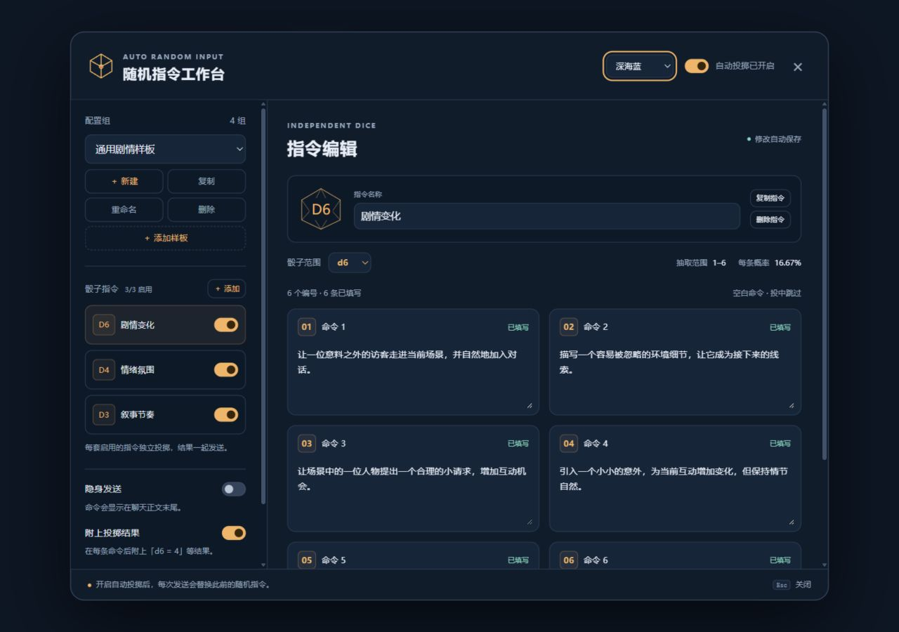
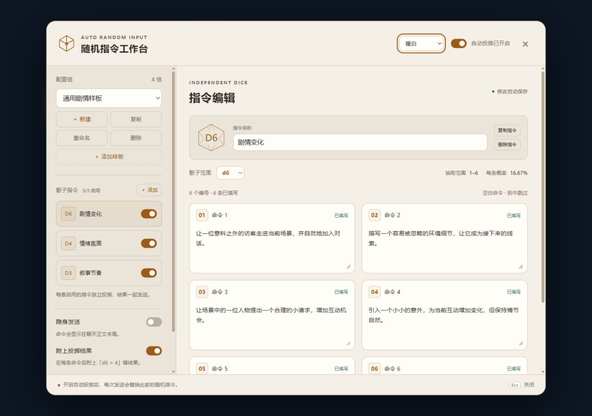

# 随机指令工作台 2.3

一个独立的 SillyTavern 前端扩展。每个配置组可以包含多套骰子指令，每套有自己的 d1～d10、d20 或 d100、命令列表和开关。发送新用户消息时，各套启用的指令独立投掷，再将命中的命令按列表顺序追加到用户输入末尾，然后交给召回等后续处理。d100 使用「骰点范围＋指令内容」的逐行编辑方式。

2.0 新增 **技能检定**：为当前聊天维护主角技能，由 AI 根据剧情选择下一轮可能用到的技能，插件本地投骰，再由 AI 根据玩家实际行动决定是否采用结果。首版用于已运行 **酒馆助手 + MVU** 的角色卡。



截图使用隔离预览中的演示配置，首次安装不会预置这些命令。

## 安装

在 SillyTavern 的「扩展 → 安装扩展」中填入仓库地址：

```text
https://github.com/anyKami/AutoRandomInput
```

也可以将本项目整个文件夹放到 SillyTavern 的 `public/scripts/extensions/third-party/AutoRandomInput` 下。刷新页面，在聊天输入框旁的扩展菜单中打开 **随机指令**。不需要执行 npm install 或构建。

**升级自动刷新（2.1.2 起）**：通过酒馆更新插件成功后自动刷新页面；通过 Git 或文件同步升级时，每30秒检查本地安装版本，确认版本变化后也会刷新。正在生成回复、编辑消息、保留输入草稿或打开工作台时暂缓，完成操作后自动继续。刷新前保存设置和当前聊天，并回读确认聊天已保存；失败时稍后重试。同版本不会反复刷新，不会主动下载更新。首次从旧版升到2.1.2需手动刷新一次，让新机制开始运行。

升级刷新测试结果见 [2.1.2 验证记录](docs/2.1.2-validation.md)。

首次安装有一个「默认配置」和一套空白 d10 指令，总开关关闭。填好命令后，打开工作台右上角的总开关。

也可以点击 **＋ 添加样板**，直接载入「通用剧情样板」，按顺序包含：自动肘击 d1、进展判定 d6、情绪氛围 d4、叙事节奏 d3。自动肘击将 AutoInstructionAppender 的三条默认指令整理为每行以 `- ` 开头的列表，合并在第 1 条中，每轮固定发送；进展判定的 1～6 依次对应失败、意外阻力、小问题、符合预期、小幅意外收获和远超预期。四套指令默认启用，每次发送分别投掷。样板作为独立配置组加入，可以自由修改；重复添加会生成新组，不覆盖已有内容。

## 使用

### 配置导入与导出（2.4）

点击工作台顶部 **导入 / 导出**，可导出当前配置，或勾选多个随机指令组、技能配置组打包为一个 JSON 文件。技能页的「导出当前配置」包含当前聊天尚未「保存到组」的修改；从组库勾选导出则使用已保存的版本。

导入时先预览名称和数量，再点击「导入为新组」。重名自动加序号，不覆盖原配置，也不自动切换或载入。普通骰子的隐藏命令和 d100 范围表都会保留；聊天记录和历史骰点不随配置分享。

面板提供 **下载示例模板**；字段说明及校验规则见 [配置文件格式 v1](docs/config-format.md)，可编辑示例后直接导入。文件处理在浏览器本地完成，无需额外服务或模型调用。

自动化与桌面、手机隔离预览结果见 [2.4 验证记录](docs/2.4-validation.md)。

### 技能检定（2.3）

在已运行 MVU 的角色卡中使用。技能检定有独立开关，默认关闭；技能表、骰型、预算、判定频率和上限按聊天保存。普通随机指令可以关闭。

采用 **骰点＋技能加值 ≥ DC 时通过**，相等也通过。总点数不截断；自然1和最大骰点没有自动成败特例。加值由用户维护，AI 只选择事件、条件及 DC。

| 骰型 | 加值范围（整数） | 新技能默认加值 | 默认总预算 |
| --- | --- | --- | --- |
| d10 | −2～+10 | +2 | 技能数 × 2 |
| d20（默认） | −4～+20 | +3 | 技能数 × 3 |
| d100 | −20～+100 | +15 | 技能数 × 15 |

**总加值预算**是技能正负加值的净和分配参考，填写非负整数。负加值会返还可分配点数。自动预算跟随技能数量和骰型变化；手动填写后固定为自定义预算，点击「使用推荐值」恢复自动预算。配置提示和配置组保存沿用名称、单项范围及预算要求，但这些提示不会阻止当前聊天发送技能检定，也不自动降低加值。

「随机分配加值」从每项下限开始随机增加点数，直到净和达到预算或全部达到上限。预算为0时也可能有相抵的正负加值；预算高于「技能数 × 骰面数」时剩余点数保留。随机分配不会改变名称、技能身份或历史骰点。切换骰型保留已填写加值、自定义预算和待判定 DC，下次使用当前骰型投骰。

**配置组**支持新建、另存为、重命名、删除、保存到组及重新载入。组库跨聊天共享；载入时复制技能，保持当前聊天的独立开关。编辑只自动保存当前聊天，「保存到组」才更新组库，其他聊天保持独立。重新载入会替换技能表，待判定继续使用当前表的加值。删除配置组保留当前聊天技能。

**升级迁移**：旧技能表和旧配置组保留名称、身份、骰型、频率与上限，将数值统一重设为新默认加值，预算恢复默认；原配置保留在各自的 `migrationSnapshot` 中。只迁移一次，后续编辑和刷新不会再次重置。历史批次仍按旧规则恢复，不把旧骰点重新解释为 DC 检定；新发送不消费缺少 DC 的旧选择。

选择技能样板后点击「添加选中样板」，将一套样板保存为独立配置组并载入当前聊天。共有12套，默认 d20、每项 +3、挑战模式、每轮上限1；5e的18项技能默认总预算54。可自由增删修改，重复添加创建独立副本。

| 样板 | 范围 |
| --- | --- |
| 5e 标准技能 | 18 项：运动、体操、巧手、隐匿、奥秘、历史、调查、自然、宗教、驯兽、洞悉、医药、察觉、求生、欺瞒、威吓、表演、游说 |
| 日常 | 生活自理、社交、工作学习、常见突发状况 |
| 修仙 | 修炼斗法、丹器符阵、宗门交涉、秘境探索 |
| 侦探 | 现场证据、推理还原、询问、跟踪潜入、电子取证 |
| 武侠 | 内功兵器、轻功暗器、医毒机关、江湖人情 |
| 西幻冒险 | 战斗魔法、地下城、野外探索、冒险交涉 |
| 末日生存 | 物资营地、探索避险、装备急救、团队协作 |
| 赛博科幻 | 网络电子、义体无人机、载具宇航、科技战术 |
| 都市异能 | 能力控制对抗、身份隐匿、现代调查、社会协作 |
| 校园成长 | 学业考试、社团文体、人际关系、自我管理 |
| 宫廷权谋 | 礼仪才艺、政治交涉、情报经营、局势应对 |
| 诡秘惊悚 | 异常调查、神秘仪式、精神抵抗、逃脱救援 |

5e 清单依据 [D&D 5e 基础规则](https://www.dndbeyond.com/sources/dnd/basic-rules-2014/using-ability-scores#Skills)，加值与预算是本插件自定义配置，不自动计算职业熟练加值。其他样板是可按世界观修改的通用清单。

d20 DC 参考为极易5、容易10、中等15、困难20、很难25、几乎不可能30，参考[典型难度等级](https://www.dndbeyond.com/sources/dnd/basic-rules-2014/using-ability-scores#AbilityChecks)。d10、d100按面数比例换算并四舍五入，属于本插件扩展。DC 可按用户要求自由设置，运行时接受可计算的数值，也支持数字字符串。

1. 当前 MVU 没有待判定时，发送选择要求；AI生成剧情后，为下一轮写入技能和 DC，事件与条件可选。
2. 下次发送直接读取当前 MVU 的待判定，按当前骰型和加值投骰、计算总点数并保存结果。普通发送仍只调用一次模型。
3. 这是自由添加意外性的工具。用户可以沿用、重复、修改或忽略检定；AI默认结合本地成败推进剧情，也可按用户要求处理。
4. 编辑回复、自动添加图片、清理导演自检、切换 swipe 或骰型、重命名或删除技能、请求 ID 不一致，都不会使待判定失效。已删除或表中没有的技能按 +0；重命名的技能优先按身份匹配当前加值，其次按同名匹配。
5. 每轮上限由用户选择1/2/3，同一技能可以重复检定。每轮模式建议至少选择一项，挑战模式按需要选择；空数组表示不安排检定。

界面展示待检定的事件、条件和DC，以及最近一批骰点的完整算式、候选成败与采用说明。回报是可选的，缺少回报不影响下次投骰。隐身发送隐藏聊天摘要，模型仍收到检定说明。

### MVU 接入与恢复

专属路径为 `stat_data.随机指令工作台.技能判定`。AI在角色卡原有MVU更新块中写入完整对象：

```json
{
  "规则版本": 2,
  "请求ID": "本次用户消息提供的请求ID",
  "本轮处理": [
    { "检定ID": "候选检定提供的ID", "处理": "采用检定", "说明": "目标与关键条件相符" }
  ],
  "待判定": [
    { "技能名": "撬锁", "对应事件": "打开仓库的黄铜门锁", "判定条件": "使用普通开锁工具，无外界干扰", "DC": 10 }
  ]
}
```

使用 `_.set('随机指令工作台.技能判定', 完整JSON对象)`，或 JSON Patch 的 `add / replace` 写入 `/随机指令工作台/技能判定`，也支持写入整个 `/随机指令工作台` 对象。请求 ID 和规则版本用于记录，不限制执行。省略更新时保留现有待判定；显式写入 `"待判定": []` 可清空。内容需要实际写入 MVU，不能只在正文展示JSON；不要覆盖整个stat_data或修改schema。

插件在 `mag_command_parsed` 中摘取专属更新，在 `mag_before_message_update` 中于卡片校验后合入，保留卡片原有变量和命令，兼容严格Zod卡。MVU版本须支持这两个事件，参见 [MVU 更新流程](https://github.com/MagicalAstrogy/MagVarUpdate/blob/beta/src/function/update_variables.ts)。

运行时只要求待判定有技能名和可计算的 DC，并执行用户设置的数量上限。事件、条件、回报及来源信息均可省略，不做回复指纹或过期选择校验。无法计算的项目会说明缺少什么数据，其他项目照常投骰。

每批结果及技能加值、DC快照保存在对应用户消息元数据。重复发送事件、取消后重试和重新生成复用已准备或保存的结果，避免一次发送意外重复投骰；下一次新发送则正常再投。角色卡删除消息元数据时无法恢复被删除的记录。

实际提示词见 [skill-prompt.js](skill-prompt.js)。插件负责本地算术，如何使用检定由用户和对话决定。自由使用调整及只读聊天回放结果见 [2.3.1 验证记录](docs/2.3.1-validation.md)。

加值、迁移及真实模型剧情/MVU 验收见 [2.3 验证记录](docs/2.3-validation.md)。

### 普通随机指令

- **配置组**：可新建、重命名、复制、删除和切换。每组保存自己的全部骰子指令；复制整组时也包含每套指令的开关、面数及隐藏命令。至少保留一组。
- **多套独立骰子**：点击左侧「＋ 添加」增加一套指令。每套都可命名、复制、删除和单独启停。选中某套只是编辑它，不影响其他已启用指令参与投掷。每组至少保留一套，全部暂停时不会投掷。
- **骰子范围**：每套分别选择 d1～d10、d20 或 d100，d100 位于 d20 后。d6 等概率抽取该套第 1～6 条，每条概率为 1/6；d20 等概率抽取第 1～20 条，每条概率为 5%；d1 固定选第 1 条。
- **按面数显示**：当前套选 d6 时只显示 6 张命令卡片，第 7～20 条内容仍保存。切回 d20 即可恢复全部 20 条；隐藏的命令不会参与抽取。
- **d100 范围指令（2.2 新增）**：每行左侧填骰点范围（如 `1-14`、`15-31`，也支持单点 `50`），右侧填指令，可增删行。起点与终点均包含在范围内；`1-14` 占14%，`15-31` 占17%。每个点数只属于一行，范围不能重叠；例如 `1-14` 与 `14-31` 在14点重叠，界面会标出两行并暂停本套 d100 投掷，修正后恢复。范围必须为1～100内的整数，起点不能大于终点。无效草稿会保留，其他骰子仍正常投掷。
- **d100 空档**：无需填满1～100。例如只覆盖1～89，投出90～100时不追加指令、不重投，最近结果会显示「未覆盖此骰点，已跳过」。范围内的空白指令也会跳过；完全空白的编辑行不参与范围校验。d100 范围表和 d1～d20 的20条编号指令分别保存，切换骰型、刷新或复制配置都保留各自内容。
- **自动保存**：输入内容立即生效，设置由 SillyTavern 自动保存。所有角色和群聊共用当前配置组；总开关、隐身模式、附加结果和主题都是全局设置。
- **空白跳过**：某套命中空白或仅含空白字符的命令时，该套不追加、不重投；其他启用的骰子照常处理。空白槽位仍占一个骰面。
- **附上投掷结果**：默认关闭。开启后，每条非空命令末尾分别附上 `（投掷结果：d6 = 4）` 这样的文字。空白命令不会单独发送结果。
- **隐身发送**：模型仍收到命令，但聊天正文不显示。当前宿主支持显示钩子时会在渲染前隐藏；旧宿主使用 HTML 注释隐藏，需关闭“显示 HTML 标签”，且未闭合的代码块可能影响显示。HTML 注释中连续的 `--` 会转义为 `-&#45;`，防止注释被命令内容提前结束。
- **最近结果**：左侧分别显示当前聊天最近一次发送时每套骰子的编号、面数和是否跳过，不受“附上投掷结果”开关影响。d100 还显示命中的范围、未覆盖的空档或未投掷的配置错误原因。
- **界面主题**：右上角可选择深海蓝、石墨黑、森林绿、暮紫、暖白，立即生效并自动保存，桌面和手机都可使用。

例如，一个组中启用「剧情 d6」和「情绪 d4」。一次发送分别投出 4 和 2，就追加剧情的第 4 条及情绪的第 2 条；两次投掷相互独立。如果情绪第 2 条为空，只追加剧情命令。

d100 的自动化与隔离酒馆实测见 [2.2 验证记录](docs/2.2-validation.md)。



## 感谢

功能思路参考 [AutoInstructionAppender](https://github.com/anyKami/AutoInstructionAppender)（作者 @Veridis）；本项目的界面、配置组与随机处理代码独立实现。
