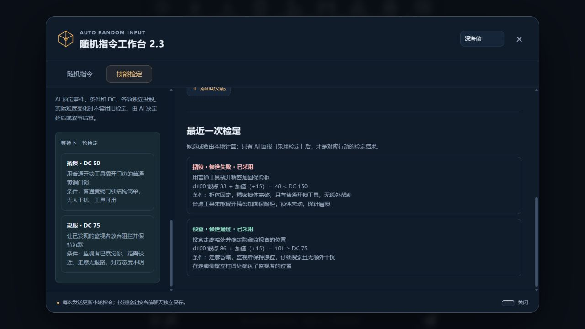

# 2.3.0 技能加值与 DC 检定验证

日期：2026-11-09。开发分支：`main-2.2.0`；`main` 保留 2.2.0。

## 自动化

`npm test`：95 项通过、0 失败。所有运行时 JS 模块通过 `node --check`，manifest、package 与加载器版本均为 `2.3.0`，`git diff --check` 通过。

覆盖三个骰型的加值上下限、负总点数、等值通过、高于骰面数的 DC、自然1/最大骰点无特例、预算正负相抵、随机分配及剩余预算；自动/自定义预算、迁移幂等和原配置快照；技能组独立性；上限1/2/3、重复/未知技能、条件与DC校验、回报缺失/重复和延后关联；发送重试、聊天/回复变更、swipe、删除后恢复和历史阈值批次重生成。

## 隔离酒馆与真实模型

使用原 `D:\tavern\.local\ari-2.0-sandbox`，SillyTavern 1.19.0，本机端口18080，独立数据与新测试卡/聊天。模型为 `liteRouter-DeepSeek V4.1 Flash Cheap (Free)`，本次无需切换付费模型。

普通MVU卡和严格Zod卡均完成真实首轮选择、下一轮检定及变量写回。定向场景使用标明的预置上一轮选择，以控制难度变化、无效输入及等值边界；后续回复由真实模型通过酒馆正常生成，不使用固定回复模拟剧情质量。d10等值场景使用已保存的固定批次触发生成，验证结果采用与恢复，不作为随机分布证据。

| 场景 | 实际观察 |
| --- | --- |
| 普通MVU首次与混合成败 | 首轮选择撬锁DC10、侦查DC15；下一轮 `13+20=33` 通过、`2−4=−2` 失败。剧情开锁成功、未确认监视者位置，原变量与插件回报同时保存 |
| 严格Zod首次与下一轮 | 首轮回合更新至1并保存两项有效选择；下一轮 `9+3≥10` 与 `16+3≥13` 均采用通过，回合2和两个目标状态同步更新 |
| 难度上升、延后 | 完整工具双手操作改为生锈铁丝左手操作，旧DC10结果不采用，下一轮改DC15，门锁仍未开 |
| 候选通过仍因条件变化失效 | 再改为无照明、左手背后盲操作；旧结果 `1+20=21≥15` 虽通过仍延后，新DC20。`<content>` 内783字，保留未决行动与完整MVU |
| 难度下降、叙事结算 | 由单手铁丝无照明改完整工具、双手和手电；旧结果 `17+3=20<25` 未套用。AI叙事开锁成功，回报「叙事结算」，不再次选择已打开的门锁 |
| d10等值通过 | 已保存批次 `6+2=8` 等于DC8，AI采用通过，门锁变量更新为true |
| 严格Zod过滤 | d10预置旧变量额外带有「严格过滤探针」；新回复未输出删除操作，该探针仍被Zod过滤，角色卡原字段和校验后合入的插件字段同时保留 |
| d100双技能、上限2 | `33+15=48<150` 开柜失败，`86+15=101≥75` 侦查成功；保险柜保持未开、监视者状态为true，总点数101未截断 |
| 同义表述与随机指令冲突 | 用户用不同措辞执行相同条件的开锁；普通d1实际注入「开锁必须成功」。技能 `10−4=6<20` 仍被采用为失败，剧情与MVU均未打开门锁 |
| 放弃行动、上限3 | 放弃开柜、观察和喊话后，三项均回报「未执行」，没有被迫执行。下一轮可写空列表 |
| 空检定轮次 | 下一次安静休息无投骰；工作台仍显示上一批自己的三项「未执行」，未被空回报覆盖 |
| 无效旧选择 | 预置缺少条件且DC为字符串的选择，界面显示跳过原因；发送不投技能骰，模型正常返回新事件、条件与数值DC13 |
| 重新生成 | 普通MVU重生成保留同一请求ID和骰点13、2，用户消息数量未增加，批次快照逐字段相同 |
| swipe恢复 | d100生成第二个swipe仍为33、86；两个回复分别保存_source.swipeId为0/1。切回0恢复该回复自己的说明，批次不变 |
| 切换聊天与迁移恢复 | 普通/严格卡独立保存；旧技能值20、8、0迁为+3、+3、+3，预算9，保留一次原快照；用户随后改为20、−4、3及自定义预算20，多次刷新未再重置 |
| 预算与界面 | d20的−5明确报越界；切d10保留−4和20并分别报错；d100推荐预算45，随机分配净和45；新增d20技能默认+3且自动预算由9变12 |
| 升级自动刷新 | 在已加载2.2的页面同步2.3文件，工作台关闭且草稿为空时自动刷新；重新进入显示2.3，聊天迁移与保存正常 |
| 手机宽度 | 390×844下工作台和技能面板无横向溢出，截图保留；测试后已恢复默认视口 |

## 实测发现与提示词修正

初次严格卡测试中，免费模型连续两次漏写 `</JSONPatch>`，角色卡变量和技能选择均未有效更新；插件跳过了无效选择，没有猜测DC或投骰。提示词补充了完整的XML标签闭合要求，重新测试确认原变量与专属字段实际写入。

长文场景还曾漏掉角色卡要求的 `<content>` 包裹；补充正文格式和禁止用MVU凑字数的提醒后，复测得到783字完整包裹的正文。初次失败记录和修正后的请求、回复均保留。

程序校验数值、来源和结构；剧情适用性采用以上真实模型场景人工核对，并结合实际MVU回读验收。

## 记录与收尾

完整记录位于 `D:\tavern\.local\ari-2.3-validation`，包含自动化日志、测试卡/场景定义、注入请求和聊天JSONL、各次变量、重生成与swipe快照、桌面/手机截图以及 `verification.json`。`verify-final.mjs` 对7个定向场景的算式、处理状态、变量、请求/分支绑定和既有批次逐项核对，全部通过。

测试完成后停止18080隔离实例，并恢复测试前的普通随机指令配置。保留隔离数据和测试记录。
