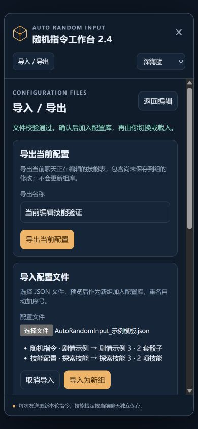

# 2.4 配置导入导出验证

验证日期：2026-11-09。基于 2.3.0 增加 JSON 格式 v1，支持随机指令组和当前技能加值配置组。

## 自动化

`npm test`：129 项通过，0 项失败。新增34项配置文件测试，覆盖：

- 混合示例、单类文件、默认值、UTF-8 BOM 和20个命令槽位补齐。
- 普通骰子与 d100、空白命令、中文多行、隐藏命令、停用规则、负技能加值和非当前骰型草稿的完整往返。
- 导出当前编辑技能表与导出组库保存版本的区别；导出不更新源对象。
- 文件内重名、重复导入、新身份和对象隔离；保留当前组和全局选项。
- JSON、格式版本、类型、骰型、范围重叠、重复技能、缺失加值、加值边界和预算错误；失败时两套组库均不变。
- 只输出配置字段，不携带内部身份、聊天关联或运行时记录。

现有普通指令、发送与召回、MVU、技能组、加值、范围表及更新刷新测试同时通过。`git diff --check` 通过。

## 隔离浏览器验证

使用本地模拟宿主，不连接模型或真实聊天。桌面与390×844手机宽度检查通过：

1. 点击「下载示例模板」，实际下载的 JSON 可通过文件选择器读取，预览显示两种配置及数量。
2. 「取消导入」清空预览，不新增组；确认导入后两套组库各增加一组，当前随机配置和聊天技能表未自动切换。
3. 再次选择同一文件，预览显示「剧情示例 → 剧情示例 2」「探索技能 → 探索技能 2」，确认后创建独立副本。
4. 载入「探索技能」，仅在聊天里把察觉加值由4改为3、每轮上限由1改为2。未保存到组直接导出当前配置，实际下载文件为3和2。
5. 勾选一个随机指令组和已保存的「探索技能」导出混合文件，实际下载文件中的技能仍为4和1；普通骰子有20槽位，d100范围表完整。
6. 选择有效文件后再改选不符合格式的 JSON，旧预览和确认按钮立即清空，随后显示格式错误，不能误导入上一个文件。
7. 手机宽度下页面宽390px，工作台宽约374px，面板没有横向溢出；导入确认、全选和全不选可用，全选8组、全不选0组。
8. 没有聊天时，当前技能导出禁用；文件输入和组库导出仍可用。
9. 运行已有「运行界面检查」，24项全部通过；主验证页面无浏览器控制台错误。

本次未测试额外服务或模型输出，因为配置文件处理无需这些功能。配置持久化沿用宿主现有的自动保存接口。
