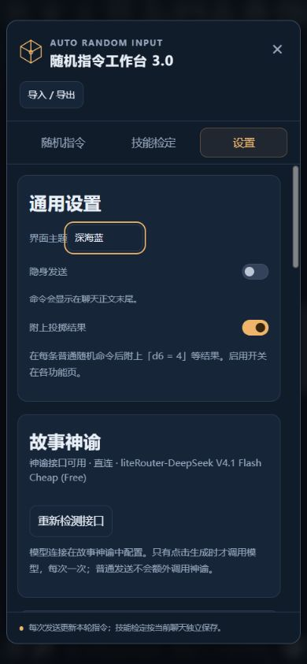
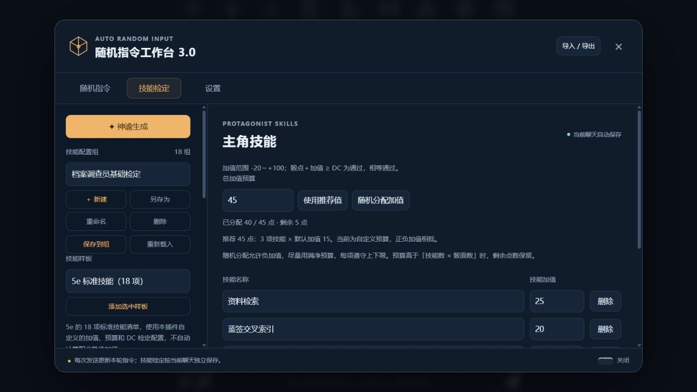

# 3.0 神谕生成与设置页验证

验证日期：2026-11-10。开发分支 `feat/config-import-export`，配置文件仍为格式 v1。

## 自动化与界面

最终版本基于远程2.4.2，保留其MVU选择接收、父命名空间写入和重新生成后通知HTML渲染器的修复。神谕预览的来源检查独立于技能选择机制；载入生成的技能表后先等待使用新表的请求，再接收下一轮选择。

`npm test`：166项通过，0项失败。其中32项新增测试覆盖生成设置、依赖探测、JSON解析、固定参数、范围重叠、技能上下限与预算、上下文裁剪、来源隔离、混合生成、仅保存、独立启用、重复应用、切换聊天／swipe／消息编辑删除、取消及超时，以及新表不立即消耗旧MVU选择。现有导入导出、普通随机指令、MVU、历史结果和升级刷新测试同时通过。

根目录运行时代码通过 `node --check`，`git diff --check` 通过。浏览器实操补充检查：

- 混合生成只调用一次模型；预览修改范围、加值与预算后实时重新校验。
- 范围重叠、d20加值小于−4和超预算均禁止应用，修正后可保存。
- 后一次非法 JSON 不会沿用前一次预览；重名加序号；保存后不能重复建组。
- 模拟接口忽略 AbortSignal 并迟到返回，取消后预览仍为空、应用按钮禁用。
- MVU未就绪时可生成并仅保存技能组，不能直接应用或开启检定。
- 通用设置保留原值，生成默认设置输入后保存，刷新后恢复；导入导出返回后仍停留在设置页。
- 390×844和320×740视口下页面、工作台及生成面板均无横向溢出；手机可编辑和保存。修复了通用设置开关受卡片样式覆盖而不可见的问题。

## 隔离酒馆与真实模型

沿用端口18080的独立酒馆，安装候选插件、故事神谕2.0.0、酒馆助手与MVU。全部调用使用 `liteRouter-DeepSeek V4.1 Flash Cheap (Free)`；未出现持续限流，无需切换付费模型。

**青岚港：严格Zod卡。** 角色是能感知灵气、辨识灵材和驾舟的巡港修士，世界书另给出已经掌握的“星砂显影法”和港内禁御剑规则。生成请求实际包含这些设定，排除禁用条目。模型生成两套d100指令，每套覆盖1～80、留下20%空档；八项技能包括特色技巧与负加值体力短板，没有赋予御剑能力。

首次模型回复漏了闭合括号，校验阻止保存，原配置保持完整。原始请求和失败回复均保留。手动重试得到合法配置；生成提示词随后增加缩进和完整闭合要求，并避免向AI推荐模式附带不生效的固定预算数值。未进行自动修复或静默重试。

预览中将预算与加值调整至净和24，保存并应用后正确切换普通组、载入技能表，并按勾选开启对应功能。首次主聊天选择“星砂显影法，DC16”；下一次插件实际掷出4，加值+4，总点8，候选失败。AI回报“采用检定”，正文未获得可用的离开方向；回读MVU，原有场景回合为2、主角身份保留、插件处理和下一轮选择同时存在。

**都市档案：普通MVU卡。** 切换到没有超自然能力的档案调查员与另一本绑定世界书。实际请求包含“蓝签交叉索引”，没有青岚港资料和禁用探针。固定d10、六项技能、每轮模式、上限3、净预算10，模型全部遵守，生成检索、访谈、电子表格、蓝签索引等技能及−1体力短板。

应用时未勾选开启，检定仍关闭。随后手动开启并发送，主聊天为三项不同技能写入DC7／6／8，普通MVU卡原有变量与插件变量同时保存。

首轮两场景的组库与聊天记录回读确认：只新增一个普通组、两个技能组；所有旧组逐项相等；配置生成本身没有向主聊天追加消息。测试期间电脑重启后，已保存配置、历史骰点与变量仍可恢复。生成草稿按设计仅在当前窗口保留。

## 最终3.0集成回归

在合入2.4.2修复后，再次用真实神谕生成d100技能表，固定三项技能、净预算45、上限2。实际输出加值为+25、+20、−5，净和40。替换旧d10技能表时，旧MVU三项待判定未被消费；首次发送结果为空，AI随后按新表选择检定。

下一轮实际掷出59+20=79≥DC50、57+25=82≥DC55，两项分别采用，普通卡回合更新到3。严格Zod卡另测5+5=10<DC15，AI采用失败，正文无法判断离开方向；原有主角、场景变量与插件字段同时保存。

隔离页面从2.4.2自动刷新到3.0.0，未手动刷新。最终3.0手机设置页在390×844下无横向溢出。上游的MVU、技能提示词和发送渲染修复文件与远程main逐字节一致，另保留了12项最终回读断言。

## 记录与边界

独立断言脚本对真实请求、模型输出、组库及聊天变量进行了15项回读检查，全部通过。原始记录位于本机 `.local/ari-3.0-validation`，不含模型密钥；保留了首次格式失败证据。

生成内容仍需要用户预览：程序校验格式、数值、来源和固定参数，模型可能返回错误JSON或不合适的内容。叙事测试确认了上述场景采用的失败结果，没有将这些有限样例视为对所有模型输出质量的保证。
