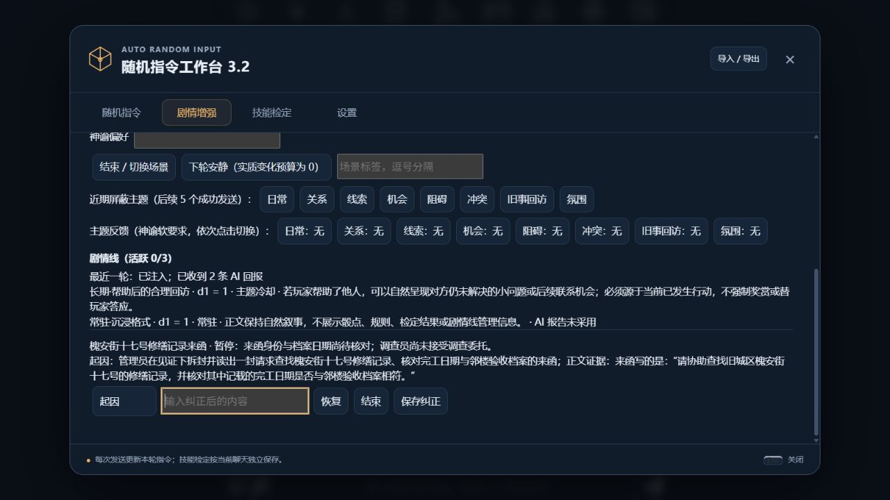

# 3.2 剧情增强验证

验证日期：2026-11-13。开发分支为 `feat/narrative-continuity`，基于 `main` 的 3.1.0。测试使用原独立酒馆 `D:\tavern\.local\ari-2.0-sandbox`、本机端口18080，正式酒馆未更新。

最终 `npm test`：235项通过，0失败、0跳过。24个运行文件的源文件、隔离安装副本及18080实际响应哈希一致。正式安装只读核对仍为3.0.2、提交 `0755815`，工作树干净。

## 验证范围

新增测试覆盖长期／场景共享预算、每套单投、空白和过滤不补抽、主题冷却、常驻要求、类型化条件、成功保存后计数，以及v1兼容和v2元数据往返。分支测试覆盖稳定消息身份、swipe、前序删除和下标复用、编辑后撤销旧回报、群聊同轮上限、手动纠正的来源基线、保存重试和续写恢复。神谕测试覆盖场景初次读取、异步场景切换、聊天切换、已结束线及嵌套条件引用。

模型桩用于可控故障和竞态；下述叙事实操均为真实API，不以桩回复代替。正文与神谕请求的实际模型字段及服务返回标识均核对为 `gpt-6-luna`，没有切换其他模型。

酒馆后端共记录22次请求及22次响应，其中正文18次、神谕4次；另有一次独立连接预检。390×844手机视口及桌面视口检查了面板操作与水平溢出，使用后恢复视口。

## 普通 MVU 与严格 Zod 卡

普通卡使用新聊天 `ARI32-普通MVU-20261113131248`。长期组、场景组共同参与调度，四套d1各投一次；显式常驻独立保留，条件不符的候选不补抽。帮助管理员整理档案后，正文提出尚待核对的索引问题，插件从正文证据建立一条剧情线，保留“管理员所述”与已核实事实的区别。

下一轮开启安静回合，实质变化被过滤，常驻与氛围条目保留；成功保存后安静状态恢复，主题冷却正常递减。重新生成复用原轮次、骰点及完整注入文本。条件编辑另验证了 `stat_data.场景.回合 >= 0` 的路径和整数输入，输入后即保存，不依赖失焦。

严格卡使用新聊天 `ARI32-严格Zod-20261113131248`。已核对酒馆助手中的 `ari25-zod` 脚本启用，使用 `registerMvuSchema` 和 `z.object`，在Zod更新事件中执行角色变量校验。实操回读确认场景、主角、技能协议v2及剧情协议v1同时保存。

连续剧情过程如下：

1. 帮船家收拾缆绳与竹篓后，船家提到船桨失踪；记录是船家的说法，没有直接认定盗窃。
2. 来到芦苇湾听取最后见到船桨的时间，追加有正文原句依据的进展。
3. 执行原定观察，实际技能骰点为11，加值5，总点16，达到DC15。正文确认刮痕和水位细节，未扩大为找到船桨，也未播报计算机制。
4. 玩家改变行动，孙子带回船桨。AI回报原问询检定“未执行”、对应剧情候选 `ignored`，核对实物后完成旧线。该轮骰点已经产生，只是未采用，没有改写成未投掷。
5. 茶摊休息与离开场景时，旧线保持完成，三条已记录进展不被重启或重复追加。

## 神谕、反馈与场景

神谕实际读取活跃剧情线，为直接相关的场景机会返回正确的 `threadId`，条件使用可执行对象或空数组。自动更新保持场景组身份不变，长期组更新前后逐值一致。神谕输出没有直接增加剧情事实。

配置每两条新AI回复更新一次：中间轮进度为1/2，到期增加一次神谕请求并归零。下一周期的请求包含“关系偏好、线索减少”；已完成线不再出现在活跃摘要，生成条目没有重新绑定它。主题屏蔽由本地过滤执行，不要求神谕改变概率。

“关系”屏蔽从5轮随成功发送递减。点击“结束／切换场景”后，旧场景层暂停，只有长期层参与下一次发送；已准备或历史快照保持不变。期间重新生成、续写、swipe及刷新均未额外消耗屏蔽或神谕进度。

## 恢复与异常回报

严格卡实测续写、新增swipe、切回旧swipe、删除一条末尾测试AI回复及重新载入。删除后的12条消息与刷新后的记录逐值一致，六份用户快照保持原样；最后一轮显示“已注入、未确认”，完成线、三条进展、反馈与1/2神谕进度均恢复。更早消息删除、下标复用及失配下游回报由专门自动化用例覆盖。

开发过程中保留了模型负例：一次神谕输出自然语言字符串条件；正文曾把 `replace` 写成JSON对象键；群聊也出现漏报、重复正文及自检文本。现有记录不会因无效回报被误更新。生成条件增加机器格式约束与严格校验，正文协议补充当前真实ID的完整JSON Patch示例、群聊逐条回报、本人正文证据和仅输出最终稿要求；没有扩大插件解析器接受范围来掩盖错误。无有效回报仍按设计保持未确认，旧事实不被推测补全。

## 群聊与手动纠正

两位角色按列表顺序回复同一条用户消息，各次请求共用一份完整发送快照。首轮格式错误保持未确认；第二轮已成功保存两份独立回报，第一位根据来函正文创建一条线，第二位重复提交的证据不在其自身正文中，没有新增线或事实。

界面依次执行暂停、恢复、修改未解决问题、再次暂停，四次操作绑定各自状态基线。刷新后玩家纠正和暂停保留。最后一轮两位离开档案馆到茶馆休息，正文未继续调查、未替玩家接受委托、未出现协议解释或重复草稿；两份回报独立保存，旧线保持玩家暂停，没有新增进展。界面用中文状态与回报数量显示，不把内部ID当作结果摘要。

需区分原始格式与集成结果：最后两份模型原始JSON数组后仍各有一个多余的 `}`，直接 `JSON.parse` 不通过。酒馆现有MVU处理成功读取了命令，回读确认角色变量、剧情对象及每条消息的分支记录实际保存。该场景通过的是叙事与主机集成验收，不能据此宣称模型原始格式完全合规；未修改MVU依赖或放宽插件校验。

## 记录与限制

原始请求、回复、逐轮MVU、重建状态、模型标识及测试日志保留于本机 `D:\tavern\.local\ari-3.2-validation`。记录只涉及专用测试聊天；发布文档不包含连接凭证或服务地址。

主要证据包括 `npm-test-final-p2.log`、`verification-matrix.md`、`host-strict-reload.json`、`host-group-third.json`、`group-third-wire-vs-persisted.json` 及 `model-summary-final.json`。最终审核将JSON Patch操作限制收窄到插件自身字段，角色卡其他操作沿用原协议；该调整通过完整自动化，未额外调用模型。验证记录已执行当前连接凭证匹配扫描，未发现匹配。

测试结束后核对进程身份并停止本次启动的隔离实例，18080端口已无监听，身份和停止结果见 `server-identity.json`、`server-stopped.json`。未停止或更新正式酒馆。

剧情证据定位只证明原文中存在相应文字，不能证明语义完全正确。以上有限场景验证了采用、忽略、推进和完成的实际表现，不代表任意模型都不会漏报或产生不合适的剧情；界面保留未确认状态和用户纠正入口。
