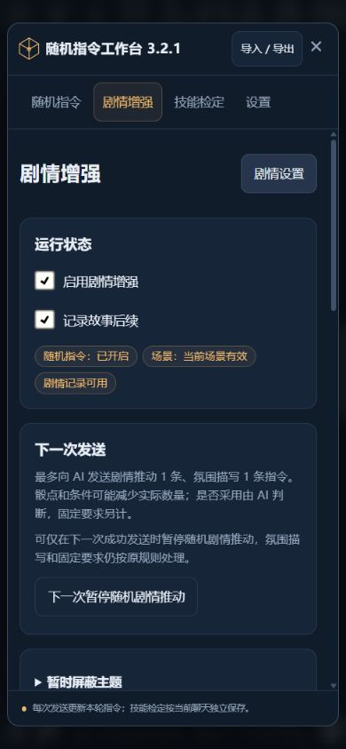
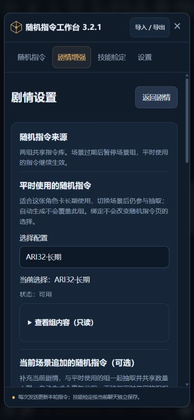
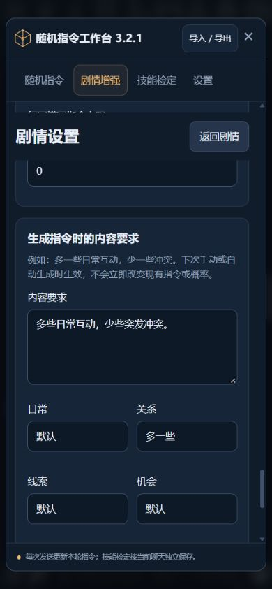
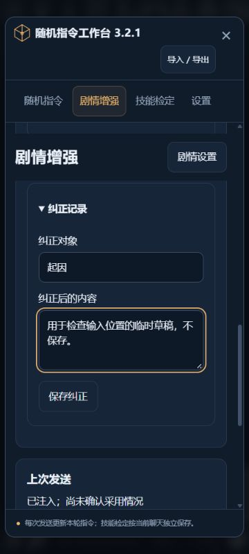
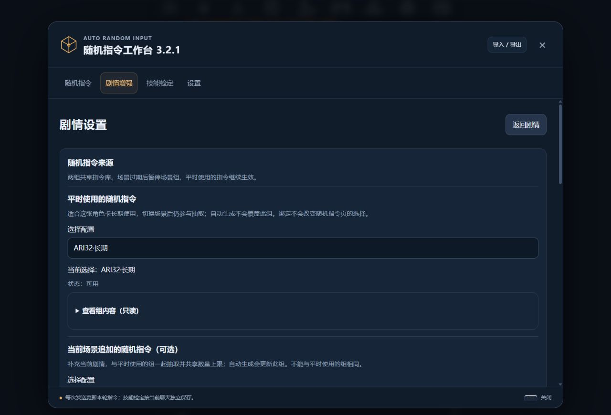

# 3.2.1 更新与验证记录

日期：2026-11-14。开发分支：`feat/narrative-continuity`，基于 `56a7f06`。

## 更新内容

- 剧情增强拆成「首页」与「剧情设置」，在工作台内切换。首页先展示实际运行状态、下一次发送、故事记录和上次发送；起因、正文依据、纠正表单与骰点按需展开。
- 「平时使用的随机指令」与「当前场景追加的随机指令」分别说明用途、当前选择和可用状态。预览只读；场景指令可停用或重新启用，不改变随机指令页的选中组。
- 用「剧情推动指令」「氛围描写指令」解释数量上限。一次性暂停只影响下一次成功发送的随机剧情推动，可取消，不承诺限制正文事件数量。
- 「生成指令时的内容要求」与主题的「默认／多一些／少一些」在下一次生成配置时使用；临时主题屏蔽在首页单独操作，显示剩余发送次数。变量路径和人工场景标签移入高级设置。
- 手机采用纵向卡片、完整页签文字、统一输入样式和可换行的完整配置名。剧情页顶部保留返回入口，各视图保存滚动位置；后台刷新保留输入与纠正草稿，群聊更换发言角色不会误清空草稿，切换聊天仍隔离。
- 上次发送只使用当前分支和 swipe 的有效回报，无有效回报时显示「尚未确认」。关闭状态分别说明功能、随机指令与剧情记录的实际情况。

本版未改变骰子规则、MVU 协议、配置格式、神谕调用周期或技能检定行为。

## 必要自动化测试

```sh
node --test test/narrative-ui.test.js
node --test --test-name-pattern 'manual corrections|narrative preparation|continuing a saved narrative|legacy sends' test/narrative.test.js test/send.test.js
```

7 项界面测试与 4 项相关发送／分支回归通过，未运行全套剧情验收。

覆盖配置选择与同组限制、0～3 上限保存、只读预览、场景停用与恢复、一次暂停与取消、生成偏好与本地屏蔽的区别、纠正保存、焦点与草稿、返回滚动、群聊及聊天隔离、当前分支回报、导航不调用模型。额外检查后台刷新等待期间的原按钮点击顺序，保存只执行一次，返回和展开操作不会被失焦重绘吞掉。

## 隔离酒馆与实际布局

沿用 `D:\tavern\.local\ari-2.0-sandbox`，地址 `http://127.0.0.1:18080/`。使用已有普通 MVU 聊天和群聊操作界面；严格 Zod 聊天仅回读对照。本次没有发送新用户消息或新增真实模型调用。

| 检查 | 结果 |
| --- | --- |
| 360×800、390×844、1280×900 | 剧情面板宽度与 scrollWidth 分别为 334、363、1068px，没有横向溢出；四页签保持完整文字 |
| 展开记录与纠正表单 | 输入框及保存按钮可见，底栏不遮挡；跨页签保留未提交草稿 |
| 长名称与返回 | 完整组名在选择框下换行；通过固定导航返回，设置页滚动位置恢复为原来的 5873.6001px |
| 偏好及数量保存 | 临时设为推动 2／氛围 0、填写内容要求和关系偏好，重新打开后 UI 与隔离 API 回读一致 |
| 暂停、屏蔽、来源 | 暂停与取消、屏蔽剩余 5 次与撤销、场景停用及恢复成功；只读预览未改变随机页选中配置 |
| 其他三个页签 | 随机指令、技能检定、设置可正常打开；自动生成入口仅导航 |
| 390×500 短可视区域 | 输入焦点保持，输入框完整位于底栏上方 |

手机尺寸检查使用浏览器视口模拟，没有在实体 Android 输入法上验证软键盘行为；短可视区域检查不能替代真实输入法兼容性验证。

操作后，严格／普通／群聊的 12／7／10 条消息与重建剧情状态均与基线一致。群聊临时设置已还原，仅真实停用／恢复带来的场景版本和配置版本记录变化；未保存测试纠正文字。严格与普通聊天配置未变。

25 个运行文件的源码、隔离副本与 HTTP 响应 SHA-256 一致。服务器记录中的 Chat Completion 请求、回复计数均为 0，错误日志为空。正式安装仍为 3.2.0、`56a7f06`，工作区干净；未同步到正式酒馆，未修改 `main`。

测试实例使用隔离配置启动，本次 Node PID 为 39148，父进程 33368。验收后停止本次启动的实例。

## 截图与本地证据

截图为浏览器中的隔离酒馆测试数据。手机头部触控尺寸随后统一为至少 44px，布局结构未变。











完整本地记录：`D:\tavern\.local\ari-3.2.1-validation`。保留定向测试日志、隔离运行日志、文件哈希、聊天前后回读与截图，不包含模型凭证。
